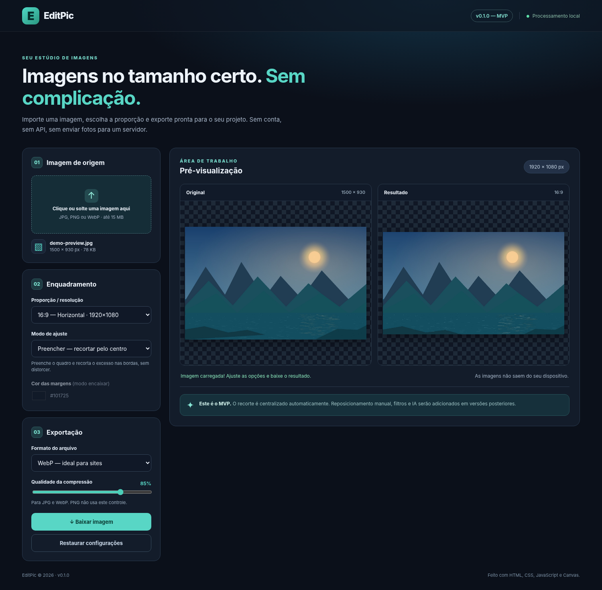

<div align="center">

# 🖼️ EditPic

**Importe. Ajuste. Padronize.**

Uma aplicação web para redimensionar, recortar e exportar imagens para sites, portfólios e redes sociais — diretamente no navegador.


**[🌐 Acessar versão online](https://mateuscanjerana.github.io/EditPic/)** · **[🗺️ Roadmap](./ROADMAP.md)** · **[🐛 Issues](https://github.com/mateuscanjerana/EditPic/issues)**

> **Status:** a V0.1.0 é o MVP inicial do EditPic. O objetivo desta etapa é validar o fluxo de importação, enquadramento e exportação antes de adicionar ferramentas avançadas.

</div>

---

## ✨ Sobre o projeto

O **EditPic** nasceu para simplificar uma tarefa recorrente no desenvolvimento de interfaces: preparar imagens com dimensões e proporções consistentes para **sites, portfólios, cards de projetos e redes sociais**.

Na **V0.1.0**, o foco está em um fluxo direto: **importar, visualizar, escolher a proporção, ajustar o enquadramento e exportar**. As transformações são realizadas localmente, sem cadastro ou backend.

A visão de longo prazo é evoluir para um **estúdio de processamento de imagens**, com tratamento fotográfico, edição não destrutiva, processamento em lote, extensão de fundos e um módulo de criação vetorial chamado **SVG Studio**.

## 🖥️ Prévia da aplicação



> Captura da **interface real da V0.1.0**, utilizando uma imagem ilustrativa de demonstração. O arquivo `docs/preview.png` deve acompanhar este README no repositório.

## ✅ Recursos da V0.1.0

- **Importação de imagens:** escolha ou arraste arquivos JPG, PNG e WebP de até **15 MB**.
- **Pré-visualização:** compare a imagem original com o resultado processado.
- **Proporções predefinidas:** 16:9, 9:16, 1:1, 4:5, 3:4 e proporção original.
- **Recorte automático:** preencha as dimensões escolhidas com recorte central, sem distorção.
- **Encaixe proporcional:** mantenha toda a imagem e preencha as margens com uma cor selecionável.
- **Exportação:** baixe os arquivos em **JPG, PNG ou WebP**.
- **Controle de qualidade:** ajuste a compressão de JPG e WebP; PNG é exportado sem esse controle.
- **Restauração de configurações:** volte aos ajustes iniciais sem descartar a imagem carregada.
- **Processamento local:** as imagens não são enviadas a um servidor pelo fluxo atual.
- **Interface responsiva:** layout adaptado a telas de diferentes tamanhos.

## 🚀 Experimente online

**Versão publicada pelo GitHub Pages:**

### 👉 https://mateuscanjerana.github.io/EditPic/

> Se o site estiver indisponível, verifique a publicação do GitHub Pages na branch `main` e na pasta `/(root)`.

## 🛠️ Tecnologias utilizadas

| Tecnologia | Utilização |
| --- | --- |
| **HTML5** | Estrutura e elementos da interface |
| **CSS3** | Estilização e responsividade |
| **JavaScript (Vanilla JS)** | Upload, interações e controle do editor |
| **Canvas API** | Redimensionamento, recorte, encaixe e exportação |
| **Git / GitHub** | Histórico de versões e colaboração |
| **GitHub Actions** | Execução automatizada dos testes matemáticos |
| **GitHub Pages** | Publicação estática da aplicação |

A V0.1.0 não requer instalação de bibliotecas por npm. **SVG.js, Fabric.js, OpenCV.js, Sharp e serviços de IA são opções para estudos futuros**, não dependências do MVP.

## 📦 Executando localmente

**Opção 1 — Abrir diretamente:** clone ou baixe os arquivos e abra `index.html` no navegador.

**Opção 2 — Servidor local (recomendado para desenvolvimento):**

```bash
git clone https://github.com/mateuscanjerana/EditPic.git
cd EditPic
python -m http.server 8000
```

Acesse **http://localhost:8000**. Também é possível usar a extensão **Live Server** no VS Code.

**Não é necessário executar `npm install`.**

### Como usar

1. Clique em **Clique ou solte uma imagem aqui** e importe um arquivo compatível.
2. Escolha a **proporção / resolução** desejada.
3. Selecione **Preencher — recortar pelo centro** ou **Encaixar — mostrar imagem inteira**.
4. Confira as prévias **Original** e **Resultado**.
5. Escolha **WebP, JPG ou PNG** e, se disponível, ajuste a qualidade.
6. Clique em **Baixar imagem**.

### Executando os testes

Com Node.js instalado, na raiz do repositório:

```bash
node --test tests/*.test.cjs
```

Os testes verificam os cálculos de proporção, recorte e encaixe. Um workflow em `.github/workflows/testes.yml` também executa os testes em pushes e pull requests na `main`.

## 🗂️ Estrutura de arquivos

```text
EditPic/
├── index.html                  # Interface principal
├── styles.css                  # Estilos e responsividade
├── src/
│   ├── app.js                  # Upload, estado e exportação
│   └── image-utils.js          # Cálculos de enquadramento
├── tests/
│   └── image-utils.test.cjs    # Testes das funções de imagem
├── docs/
│   └── preview.png             # Captura real do MVP
├── .github/
│   └── workflows/
│       └── testes.yml          # Testes no GitHub Actions
├── README.md                   # Apresentação do projeto
├── ROADMAP.md                  # Planejamento das próximas versões
├── CHANGELOG.md                # Histórico de mudanças
└── GIT-GUIDE.md                # Guia de Git e publicação
```

## 🧭 Roadmap

| Versão | Direção de evolução | Situação |
| --- | --- | --- |
| **V0.1.0** | Upload, proporções, recorte automático e exportação | **MVP** |
| **V0.2.0** | Recorte manual, movimentação e zoom | Planejado |
| **V0.3.0** | Brilho, contraste, exposição e saturação | Planejado |
| **V0.4.0** | Histórico de alterações e presets | Planejado |
| **V0.5.0** | **SVG Studio:** artes vetoriais para cards de projetos | Planejado |
| **V0.6.0** | Processamento em lote e download ZIP | Planejado |
| **V0.7.0** | Remoção de fundo e ajuste de máscaras | Planejado |
| **V0.8.0** | Extensão de background | Planejado |
| **V0.9.0** | Edição não destrutiva e camadas | Planejado |
| **V0.10.0** | Revisão técnica e testes abrangentes | Planejado |
| **V1.0.0** | Primeira versão estável | Visão futura |

O detalhamento técnico está disponível em **[ROADMAP.md](./ROADMAP.md)**.

### 🎨 SVG Studio — planejado

Módulo para criar **artes SVG personalizáveis** para cards de projetos e banners, com modelos geométricos, gradientes, padrões, paletas reutilizáveis e ícones opcionais. A proposta inicial utiliza **SVG nativo e bibliotecas públicas**, como SVG.js, Lucide e Tabler Icons, sem depender de uma API generativa.

### 🤖 Recursos de IA — visão futura

Poderão ser avaliados remoção de fundo, refinamento de máscaras, restauração, super-resolução e expansão generativa de cenários. A prioridade será usar **métodos locais gratuitos** sempre que oferecerem resultados adequados. Esses recursos **não estão disponíveis na V0.1.0**.

## ⚠️ Limitações atuais

- O recorte é centralizado; a movimentação e o zoom manuais ainda não estão disponíveis.
- Não há filtros fotográficos, camadas, máscaras, histórico de edição ou edição de SVG.
- Não há remoção ou expansão de fundo, processamento em lote nem IA integrada.
- Arquivos SVG, HEIC, RAW e formatos animados não são aceitos como entrada.
- Na proporção original, imagens muito grandes são limitadas a **4096 px na maior dimensão e aproximadamente 8 milhões de pixels** para reduzir o consumo de memória.
- A exportação via Canvas pode não preservar metadados e perfis de cor do arquivo original.
- Aumentar a resolução por redimensionamento convencional **não recupera detalhes que não existiam**.

> Antes de publicar uma imagem em um site, confira o enquadramento, a nitidez e as dimensões do arquivo exportado.

## 🔒 Privacidade

O MVP processa as imagens **no navegador do usuário**. Não há envio de fotografias a um servidor da aplicação por meio do fluxo atual de edição e exportação.

Funcionalidades remotas futuras, quando implementadas, deverão informar o envio de imagens a serviços externos e apresentar as condições correspondentes. O projeto não passou por auditoria independente de segurança.

## 🌐 Publicação no GitHub Pages

1. Envie o código do projeto para o repositório **[EditPic](https://github.com/mateuscanjerana/EditPic)**.
2. Mantenha `index.html` na raiz, junto com `styles.css`, `src/` e `docs/preview.png`.
3. Vá em **Settings → Pages → Build and deployment**.
4. Em **Source**, selecione **Deploy from a branch**.
5. Escolha a branch **`main`** e a pasta **`/(root)`**, depois salve.
6. Quando o deploy terminar, acesse **https://mateuscanjerana.github.io/EditPic/**.

O endereço permanece o mesmo nas próximas atualizações enviadas à branch de publicação.

## 🔖 Versionamento

O EditPic utiliza o padrão **MAJOR.MINOR.PATCH**, com releases e tags como `v0.1.0`, `v0.2.0` e `v1.0.0`. As modificações são registradas em `CHANGELOG.md`.

Exemplos de mensagens de commit:

```text
feat: adicionar recorte manual
fix: corrigir exportação PNG
docs: atualizar README
refactor: separar lógica de imagem
test: adicionar testes de enquadramento
```

## 🤝 Contribuições e feedback

Sugestões, relatos de bugs e propostas de melhoria podem ser registrados na aba **[Issues](https://github.com/mateuscanjerana/EditPic/issues)**. Pull requests são bem-vindos e devem descrever claramente as alterações realizadas.

## 👨‍💻 Desenvolvimento

Desenvolvido por **[Mateus Canjerana](https://github.com/mateuscanjerana)** como projeto de estudo e prática em desenvolvimento web, processamento digital de imagens e engenharia de software.

**EditPic — de imagens comuns a arquivos prontos para seus projetos.**

> **Licença:** ainda não definida. Para estabelecer permissões explícitas de reutilização e redistribuição, será necessário adicionar um arquivo `LICENSE` ao repositório.
